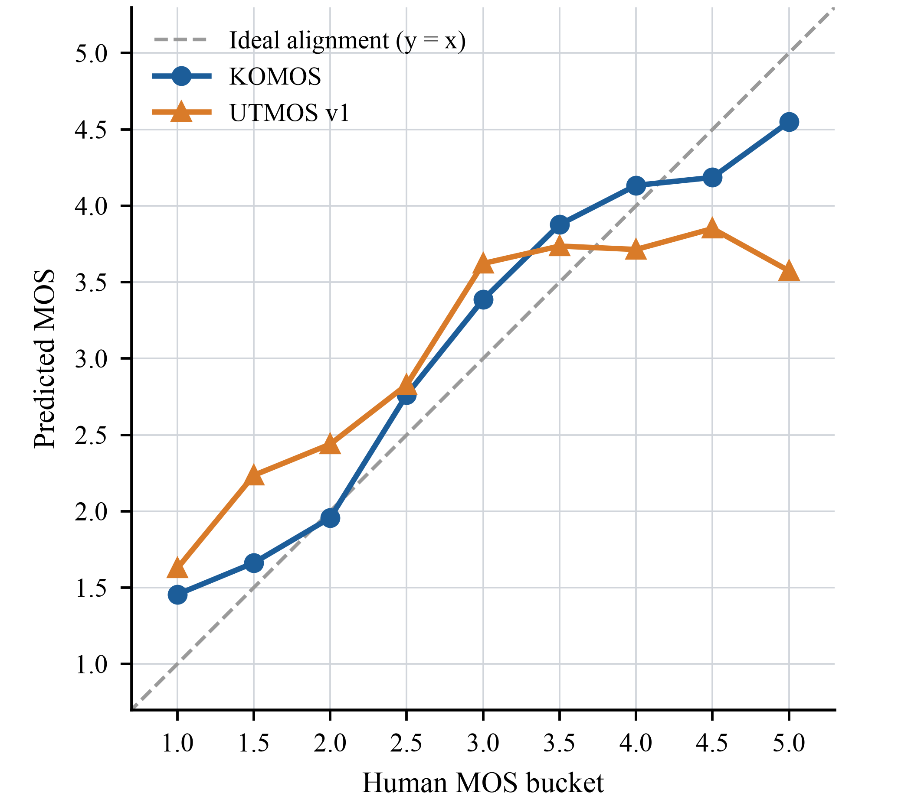

<h1 align="center">KOMOS</h1>

<p align="center"><strong>Automatic Mean Opinion Score Estimation for Korean Speech</strong></p>

<p align="center">
  <a href="https://arxiv.org/abs/2610.15353"></a>
  <a href="https://huggingface.co/upskyy/komos"></a>
  <a href="https://github.com/upskyy/komos"></a>
</p>

KOMOS is a Korean mean opinion score predictor for overall speech quality across read and spontaneous speech. It combines a fully fine-tuned Whisper-medium encoder with a listener-conditioned prediction head and returns a score on the 1–5 MOS scale.

## Highlights

- Trained with 5,000 ratings from 29 native Korean listeners for 1,000 utterances.
- Covers real recordings, synthesized speech, and degraded speech.
- Supports PyTorch and ONNX Runtime inference.

## Results

### Human MOS alignment

On the Korean test set, KOMOS follows the human MOS scale more closely than UTMOS v1.

<p align="center">
  
</p>

<p align="center"><em>Mean predicted MOS by human-MOS bucket after validation-set affine calibration. The dashed line shows ideal alignment.</em></p>

### Overall test performance

Utterance-level correlation with human MOS on the 100 utterance test set. UTMOS v1 and v2 are evaluated as English-trained zero-shot baselines, while KOMOS is fine-tuned on Korean quality ratings.

| Model | Test SRCC ↑ | Test LCC ↑ |
| --- | ---: | ---: |
| UTMOS v1 | 0.703 | 0.798 |
| UTMOS v2 | 0.767 | 0.858 |
| **KOMOS** | **0.900** | **0.950** |

### Speaker-disjoint and text-disjoint evaluation

Utterance-level SRCC on test subsets whose speakers or texts are absent from both the training and validation sets.

| Model | Overall ↑ | Speaker-disjoint ↑ | Text-disjoint ↑ |
| --- | ---: | ---: | ---: |
| UTMOS v1 | 0.703 | 0.818 | 0.719 |
| UTMOS v2 | 0.767 | 0.823 | 0.778 |
| **KOMOS** | **0.900** | **0.951** | **0.878** |

## Installation

Python 3.10 or later is required.

Install KOMOS directly from GitHub:

```bash
pip install "komos @ git+https://github.com/upskyy/komos.git"
```

To work from a local checkout instead:

```bash
git clone https://github.com/upskyy/komos.git
cd komos
uv sync --no-dev
```

## Quickstart

### PyTorch

```python
from komos import KOMOS

model = KOMOS.from_pretrained("upskyy/komos").eval()
score = model.score("audio.wav")
print(score)
```

Move the model to CUDA with `model.to("cuda")` when GPU inference is needed.

### torch.hub

```python
import torch

model = torch.hub.load("upskyy/komos:main", "komos", trust_repo=True)
print(model.score("audio.wav"))
```

### ONNX Runtime

```bash
pip install "komos[onnx] @ git+https://github.com/upskyy/komos.git"
```

```python
from komos.onnx import KOMOSOnnx

model = KOMOSOnnx.from_pretrained("upskyy/komos")
score = model.score("audio.wav")
print(score)
```

## Inference

`score()` accepts an audio path or a mono NumPy array or PyTorch tensor with an explicit sample rate. File inputs are downmixed to mono and resampled to 16 kHz.

- `score()` evaluates up to the first 10 seconds and returns a validation-calibrated score clipped to the 1–5 range.
- `score_long_form()` supports recordings of up to 60 seconds and computes a duration-weighted mean of raw scores from non-overlapping 10-second chunks before calibration.
- Inputs longer than 60 seconds should be processed in external batches.

## Citation

If you use KOMOS in your research, please cite:

```bibtex
@misc{ha2026komos,
  title         = {KOMOS: Automatic Mean Opinion Score Estimation for Korean Speech},
  author        = {Sangchun Ha and Junwon Moon and Kyuhong Shim},
  year          = {2026},
  eprint        = {2610.15353},
  archivePrefix = {arXiv},
  primaryClass  = {eess.AS},
  url           = {https://arxiv.org/abs/2610.15353},
}
```

## License

KOMOS is released under the MIT License. See [LICENSE](LICENSE) and [NOTICE](NOTICE).
